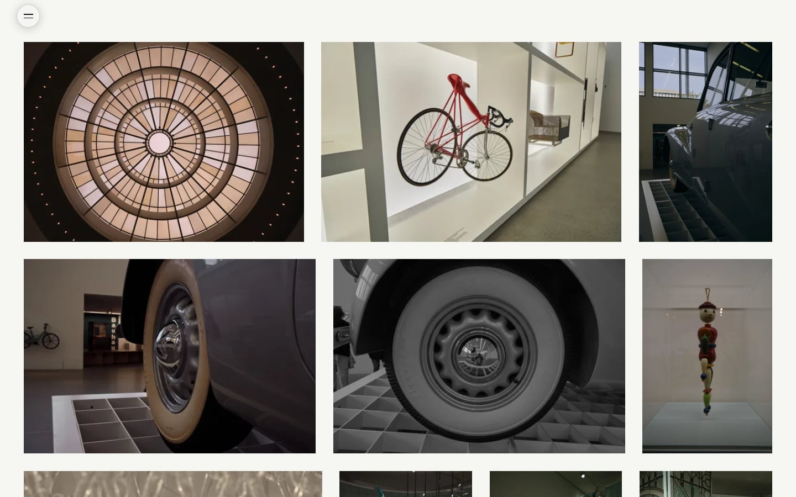
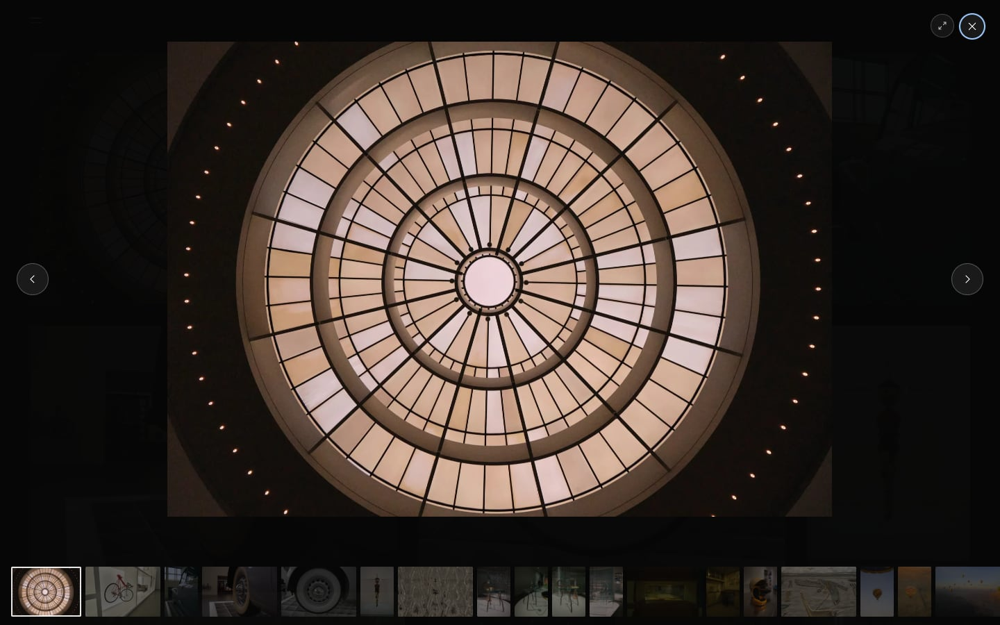

# Photobook

A fast, minimal photography portfolio template built with [Astro](https://astro.build) and [Preact](https://preactjs.com).

<picture>
  <source media="(prefers-color-scheme: dark)" srcset="./docs/preview-dark.jpg" />
  <source media="(prefers-color-scheme: light)" srcset="./docs/preview-light.jpg" />
  
</picture>

| Collections | Lightbox |
| :--: | :--: |
|  |  |

## Features

- **Zero-crop justified grid** — pure CSS flexbox layout that preserves every photo's aspect ratio before hydration and with JavaScript off.
- **Full-bleed collections** — alternating split panels with wheel, swipe, and keyboard navigation.
- **Lightbox & filmstrip** — keyboard (`←`, `→`, `F`, `Esc`), swipe, and fullscreen support with neighbour preloading.
- **Animated light/dark theme** — radial color wash using registered CSS `@property` tokens, respecting `prefers-reduced-motion`.
- **Motion tiles** — video tiles that lazy-load near the viewport and play on hover.
- **Static shareable routes** — pre-rendered pages for every photo (`/photos/<id>/`) and collection (`/collections/<slug>/`), per-photo 1200×630 Open Graph cards, sitemap, and `robots.txt`.
- **Scalable payloads & image pipeline** — each page embeds its first batch of 48 tiles while `/catalog.json` loads the rest. Sharp generates content-hashed variants, strips source EXIF, and supports local builds or remote CDNs.

## Quick start

Requires Node `>= 22.23.4`.

```sh
pnpm install
pnpm dev
```

| Command | Action |
| :-- | :-- |
| `pnpm dev` | Start dev server on `localhost:4321` (`astro dev --background` to detach) |
| `pnpm check` | Run `astro check` and Biome lint/format checks |
| `pnpm lint:fix` | Auto-format and fix lint issues with Biome |
| `pnpm test` | Run Vitest unit tests |
| `pnpm build` | Build static site to `dist/` (run `pnpm check` to typecheck) |
| `pnpm preview` | Preview the built `dist/` output |

## Adding photos and collections

Put images in `src/photos/`. Loose files appear first in **all**; one-level subfolders become collections sorted numerically by filename.

```text
src/photos/
  blue-hour.jpg
  iceland/
    01-morning.jpg
    02-glacier.jpg
```

Collection names cannot be nested or use reserved menu keys (`all`, `featured`, `collections`, `about`).

### Import scripts

Keep raw camera originals out of Git. Use the import scripts to downscale masters into `src/photos/` (collection argument is optional):

```sh
node scripts/import-photos.mjs ~/Pictures/iceland-2025 iceland
node scripts/import-videos.mjs ~/Footage/tide.mov low-tide --seconds 6 --poster 2
```

`import-videos.mjs` requires `ffmpeg`, writes a stripped MP4 into `public/video/`, extracts a matching cover still into `src/photos/`, and prints the frontmatter snippet.

### Metadata and About

Metadata is optional and sparse. For a collection, add `src/content/collections/<folder>.md` (or `src/content/photos.md` for loose photos):

```yaml
---
title: "iceland"
year: "2025"
order: 1
cover: "02-glacier.jpg"
photos:
  - file: "01-morning.jpg"
    alt: "Basalt cliffs under a deep blue pre-dawn sky"
    featured: true
    caption: "Vík, 04:20" # shown when grid.showCaptions is true
---
```

Edit `src/content/about.md` for the About page, or delete it to hide the menu entry. The **featured** and **collections** menu entries also appear only when content exists for them.

## Configuration

Edit [`photobook.config.ts`](./photobook.config.ts) to set `site`, `title`, `description`, `ogImage` (keep JPEG/PNG for social crawlers), `personalSite`, EXIF `credit`, grid `rowHeight`/`showCaptions`, default `theme`, image `widths`/`format`/`quality`, and `source` (`local` or `remote`).

Replace `site` and `public/og-image.jpg` before deploying.

## Architecture

| Path | Responsibility |
| :-- | :-- |
| `pipeline/` | Sharp image pipeline shared by the Astro integration and CLI |
| `src/integrations/` | Astro hooks to run the pipeline, watch/serve `/img/` in dev, and copy variants to `dist/` |
| `src/core/` | Pure shared logic: types, naming, variant keys, routing, and pool slicing |
| `src/data/` | Server-side assembly of `photos.manifest.json` and content collections |
| `src/client/` | Preact app: per-island store, history navigator, hooks, and UI components |
| `src/styles/` | Design tokens, keyframes, and per-feature stylesheets |
| `tests/` | Vitest unit tests for `src/core/` and `src/data/` |

## Deploying

`pnpm build` produces a static `dist/` folder with no server runtime. See [`DEPLOYMENT.md`](./DEPLOYMENT.md) for Cloudflare Workers, Cloudflare Pages, GitHub Pages, VPS nginx setup, subpath `base` deploys, Cloudflare R2 CDN hosting, and troubleshooting.

## License

Code is licensed under [MIT](./LICENSE).
